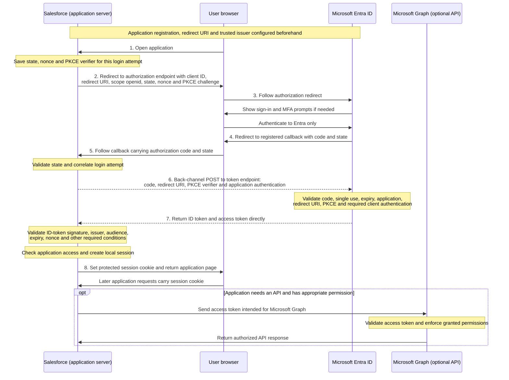

# OpenID Connect Login: Clean Diagram

Conceptual authorization-code flow for a confidential server-side web application, with PKCE. Microsoft Entra ID is the identity provider and Salesforce is the example relying party. All network messages use HTTPS.

**Dashed arrows 6 and 7 identify the direct back-channel exchange.** They do not travel through the browser. Solid arrows show the other illustrated network requests and responses; the API call is also server-to-server.

- The authorization code is short-lived and single-use.
- The ID token supplies identity proof to its intended application.
- The access token is for its intended API; it is not the browser's application-session cookie.
- The application session is maintained separately by the session cookie.
- PKCE and client authentication protect different aspects of the code exchange.

This clean diagram was prepared with assistant help from the [original hand drawing](oidc-flow-handdrawn.png) and the corrections discussed during the lab. It illustrates a server-side web application flow, not every OIDC client architecture or a deployed Salesforce integration.
