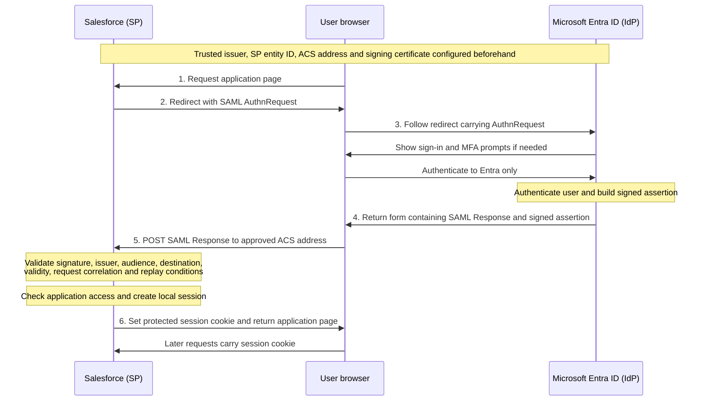

# SAML Login: Clean Diagram

Conceptual SP-initiated browser redirect/POST flow. Microsoft Entra ID is the IdP and Salesforce is the example service provider. All network messages use HTTPS.

The application does not receive the user's Entra password. In this redirect/POST flow the browser carries the sign-in messages; no direct SP-to-IdP token exchange occurs.

This clean diagram was prepared with assistant help from the [original hand drawing](saml-flow-handdrawn.png) and the corrections discussed during the lab. It illustrates the flow, not a deployed Salesforce integration.
