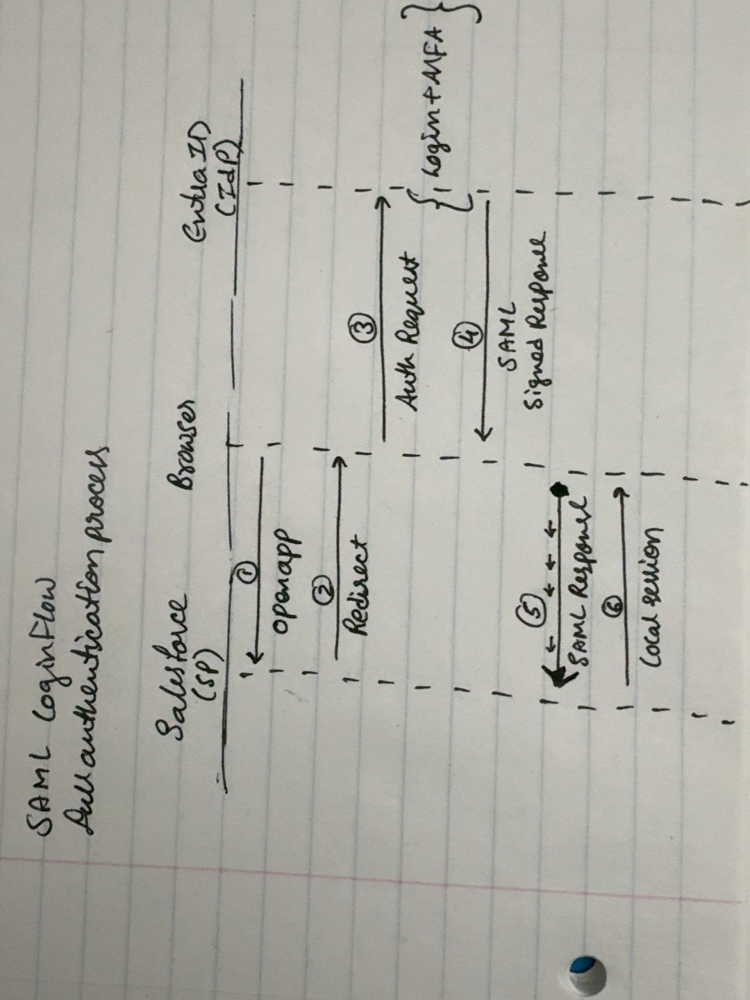
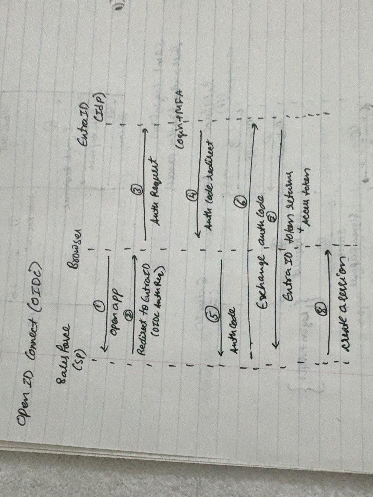

# SAML and OpenID Connect

Notes refined during guided Lab 3 practice. The original hand drawings are preserved unchanged, including their working labels.

## SAML browser flow

1. The browser opens Salesforce.
2. Salesforce redirects the browser toward Entra with a SAML AuthnRequest.
3. Entra authenticates the user, including MFA when required. The user supplies credentials to Entra, not Salesforce.
4. Entra returns a SAML Response containing a signed assertion through the browser.
5. The browser posts the response to Salesforce's assertion consumer service (ACS).
6. Salesforce validates the signature and required conditions, checks access, creates a local session, and sends a session cookie to the browser.

### Clarifications for the working drawing
- Arrow 3 carries the AuthnRequest.
- Arrows 4 and 5 carry the SAML Response containing the signed assertion.
- Validation and local-session creation happen inside Salesforce. The final arrow to the browser represents setting the session cookie.
- This is the browser redirect/POST SAML flow studied here; its sign-in messages pass through the browser.

### Questions practised
**What if Salesforce accepted an assertion intended for another application?** It could allow unauthorized access using proof issued for a different application. Salesforce must enforce the audience restriction.

**Why does the assertion expire?** Expiry limits the opportunity to use stolen proof. Replay detection is also needed; expiry alone does not prevent reuse.

**What is needed to verify the signature?** Entra's trusted public signing certificate or matching public key, established through trusted configuration beforehand. Entra keeps its private signing key secret.

## OIDC authorization-code flow

1. The browser opens Salesforce.
2. Salesforce initiates an authorization request through the browser, including its client ID, registered redirect URI, the openid scope, state, nonce, and a PKCE challenge where applicable.
3. Entra authenticates the user.
4. Entra redirects the browser to Salesforce with a short-lived authorization code.
5. Salesforce receives the code through the browser.
6. Salesforce sends the code directly to Entra's token endpoint over HTTPS, with the required application authentication and PKCE verifier as applicable.
7. Entra validates the exchange and returns tokens directly to Salesforce.
8. Salesforce validates the ID token, checks access, creates a local session, and sends a session cookie.

### Clarifications for the working drawing
- Arrows 6 and 7 are direct server-to-server back-channel calls. They cross the browser column on paper but do not pass through the browser. They should be dashed in a clean redraw.
- The application validates the ID token's signature, issuer, audience, expiration, nonce, and other required conditions before starting a session.
- Local-session creation occurs on the application server; the browser receives a session cookie.
- Authorization codes are single-use. Reusing one must fail.
- Signing keys are reused across many tokens and rotated over time; they are not newly generated for every session.

### Questions practised
**ID token versus access token?** An ID token tells its intended application about the authenticated user. An access token is presented to its intended API with granted permissions. A Microsoft Graph access token is not Salesforce's login proof, and Salesforce's ID token is not a credential for calling Graph. The session cookie maintains the browser's application session.

**What is the nonce for?** The application saves a random value for the login attempt and checks the ID token's nonce against it. This binds the token to that authentication request and helps detect replay. A mismatch must be rejected.

**Why use discovery?** A trusted discovery document gives endpoint addresses and a jwks_uri pointing to public signing keys. Applications can retrieve updated keys during rotation rather than relying on one hard-coded key. Discovery and keys still require validation against the expected issuer.

## Comparison
| Aspect | SAML flow studied | OIDC code flow studied |
|---|---|---|
| User authentication | Entra | Entra |
| Identity proof | XML assertion in a SAML Response | ID token, normally a JWT |
| Browser return | SAML Response posted to the ACS | Authorization code sent to the redirect URI |
| Direct token exchange | None in this redirect/POST flow | Application exchanges code at token endpoint |
| Application checks | Signature, issuer, audience, destination, validity, request correlation and replay conditions | Signature, issuer, audience, validity, nonce and other required conditions |
| Application session | Local session and browser cookie | Local session and browser cookie |

Both depend on trust configured before login and avoid sharing the user's IdP password with the application. SAML remains common in enterprise software because existing integrations and long product lifetimes make migrations costly; both protocols need to be understood.

## Still to complete
Clean redraws and the separate trust/security and explain-back documents will follow. These original sketches record the learning process.
